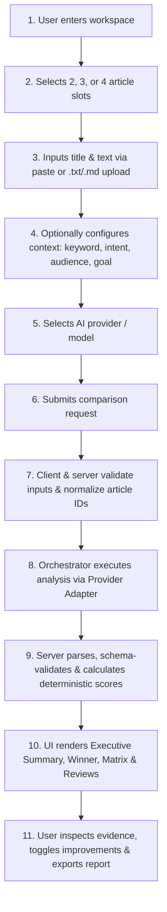

# 01 — Product Requirements Document (PRD)

**Product:** ArticleCompare AI  
**Status:** Approved for Implementation (MVP Phase)  
**Author:** Product & Architecture Team  
**Technology Baseline:** Next.js 15 App Router | JavaScript/JSX | Tailwind CSS | OpenAI & Google Gemini | No Database (Stateless)  

---

## 1. Product Overview & Vision

### 1.1 Overview
**ArticleCompare AI** is an AI-assisted editorial evaluation and decision-support platform. A user submits 2, 3, or 4 article drafts and supplies optional context (such as target keyword, search intent, audience profile, and editorial goals). The platform evaluates each article draft both independently and comparatively against a shared, structured rubric. It delivers a structured, explainable report answering:
- Which article is strongest for the stated purpose, and by what margin?
- What verifiable evidence in the submitted text justifies that recommendation?
- Where does each article succeed or fall short?
- What critical subtopics, user questions, or explanations are missing across all drafts?
- How can an editor combine the best elements of each draft into a superior final piece?
- What specific, prioritized revisions must be completed before publication?

### 1.2 Vision
To establish the industry-standard editorial decision workspace that empowers content teams, editors, and SEO professionals to select, synthesize, and polish high-performing articles with complete transparency and zero guesswork.

---

## 2. Problem Statement

Modern content production teams frequently compare multiple drafts from in-house writers, freelancers, or AI generators. Today, this process is broken:
1. **Slow & Inconsistent Manual Review**: Editors juggle multiple browser tabs or documents, relying on subjective, ad-hoc impressions that vary from editor to editor and day to day.
2. **Generic AI Rewriting Fallacy**: Standard conversational AI tools rewrite articles without justifying *why* one approach is superior, often favoring verbose padding over substance.
3. **Hallucinated SEO & Fact Claims**: Untrusted AI tools regularly fabricate search volume statistics, keyword difficulty scores, and backlink predictions, or claim factual veracity without verification sources.
4. **Lack of Actionable Synthesis**: Existing tools rarely provide a concrete roadmap to merge the strongest sections of competing drafts into a cohesive master piece.

ArticleCompare AI solves these issues by providing a repeatable, fair comparison framework, explicit scoring criteria, textual evidence citations, and an actionable revision plan.

---

## 3. Target Users & Personas

### 3.1 Primary Personas
- **Senior Content Editor**: Oversees editorial quality across multiple writers. Needs to rapidly evaluate 2–4 competing drafts and provide concrete, constructive feedback.
- **SEO Strategist / Content Lead**: Analyzes search-intent alignment, topical coverage, heading structures, and on-page fundamentals before content goes live.
- **Solo Publisher / Website Owner**: Seeks a fast, objective pre-publish audit to ensure their content meets high standards without an enterprise budget.
- **Staff Content Writer / Freelancer**: Reviews detailed feedback to identify content gaps and refine their drafting skills.
- **Agency Account Lead**: Standardizes client deliverables and generates transparent, exportable audit reports demonstrating quality control.

### 3.2 Core User Needs
| Need | Description |
|---|---|
| **High-Efficiency Comparison** | Fast, side-by-side evaluation of 2–4 articles in a single session. |
| **Objective Rubric** | Identical evaluation criteria applied equally to all submitted drafts. |
| **Explainable Evidence** | Transparent reasoning linking scores to specific text excerpts, headings, or structural elements. |
| **Gap Detection** | Clear identification of missed subtopics, unanswered audience queries, and unverified factual assertions. |
| **Portability & Export** | One-click export of structured reports (JSON and Markdown) for client or team sharing. |
| **Provider Agility** | Consistent evaluation quality whether running on OpenAI or Google Gemini. |

---

## 4. Goals and Non-Goals

### 4.1 Product Goals
- **G-1: Reduce Review Time**: Cut editorial draft comparison time by at least 60% compared to manual side-by-side reading.
- **G-2: Standardize Quality**: Ensure all drafts are evaluated against an immutable 10-dimension rubric with zero bias.
- **G-3: Uncover Content Gaps**: Reliably identify omissions in topical depth, sub-intent satisfaction, and practical examples.
- **G-4: Enable Hybrid Synthesis**: Provide an actionable blueprint ("Hybrid Recommendation") to construct a definitive article from the strongest components.
- **G-5: Provider Decoupling**: Architect a robust provider adapter abstraction supporting OpenAI and Google Gemini interchangeably.

### 4.2 Explicit Non-Goals
To prevent feature creep and maintain strict product boundaries, ArticleCompare AI will **NOT**:
- ❌ Guarantee search engine rankings (Google, Bing, etc.) — ranking depends on external factors (backlinks, domain authority, technical SEO, user signals) outside text analysis.
- ❌ Invent or display search volume, keyword difficulty, or traffic estimations unless connected to an official third-party data provider.
- ❌ Assert that an unverified claim is an established fact without external citation checking (MVP operates strictly in text-only evaluation mode).
- ❌ Act as an automated plagiarism detection service (requires dedicated fingerprinting/similarity engines).
- ❌ Direct publish to external CMS platforms (WordPress, Webflow, Ghost) in MVP.
- ❌ Make authoritative legal, medical, or financial accuracy determinations (YMYL advice requires certified human expertise).
- ❌ Equate length or word count with editorial quality.

---

## 5. Core User Journey

1. **Access**: User loads the single-page comparison workspace.
2. **Slot Selection**: User selects 2, 3, or 4 comparison slots (default: 2).
3. **Draft Input**: User pastes text or imports `.txt`/`.md` files for each article. Character counts and validations update in real-time.
4. **Context Configuration**: User opens the collapsible context drawer to optionally specify primary keyword, search intent, target audience, tone, and editorial goal.
5. **Provider Choice**: User selects between configured providers (OpenAI or Gemini) or accepts system default.
6. **Submission**: User triggers "Compare Articles".
7. **Validation & Normalization**: Request payload is validated against strict schemas; stable IDs (`A`, `B`, `C`, `D`) are assigned.
8. **AI Engine Execution**: System instruction and versioned prompt evaluate all articles simultaneously against the 10-dimension rubric.
9. **Processing & Scoring**: Structured JSON is validated; overall score is computed deterministically by weighted formula.
10. **Interactive Report**: Executive summary, winner banner (or tie indicator), comparative matrix, and deep-dive cards render.
11. **Action & Export**: User reviews textual evidence, checks off editorial improvements, and exports report as JSON or Markdown.

---

## 6. Functional Scope by Release

### 6.1 Phase 1 — MVP (Current Release Scope)
- Compare 2, 3, or 4 article slots.
- Direct text paste and file upload for `.txt` and `.md`.
- Optional comparison context: Primary Keyword, Search Intent, Target Audience, Editorial Goal, Tone, Content Language.
- Server-side provider integration for OpenAI (`gpt-4o`) and Google Gemini (`gemini-2.5-flash` / `gemini-1.5-pro`).
- Individual article evaluation across 10 distinct rubric dimensions.
- Comparative Matrix mapping all submitted articles side-by-side per dimension.
- Defensible Winner Recommendation with confidence rating and rationale (or explicit No Clear Winner / Close Tie state).
- Identified Strengths, Weaknesses, Content Gaps, and Editorial Issues per article.
- Shared Gap Analysis highlighting topics absent across all drafts.
- Prioritized Improvement Checklist (High, Medium, Low).
- On-Page SEO metadata recommendations (SEO title, meta description, URL slug, secondary keywords, FAQ suggestions).
- Structured JSON report export.
- Fully responsive, accessible interface (WCAG 2.2 AA compliant).
- Comprehensive error handling and user feedback.

### 6.2 Phase 1.1 (Enhancement Release)
- Browser-local comparison history via `localStorage` (transient, zero server storage).
- Section-by-section clipboard copying.
- Re-run comparison with modified context parameters.
- Side-by-side synchronized article viewer.
- Enhanced provider retry logic with exponential backoff.
- Markdown (`.md`) formatted report export.

### 6.3 Phase 2 (Advanced Ingestion & Reporting)
- User authentication and optional cloud projects (if confirmed by user requirement).
- Safe URL text extraction with strict SSRF defense.
- Document upload support for `.docx` and `.pdf` with isolated sanitization.
- Public read-only shareable report links.
- Print-optimized CSS and PDF report export.
- Usage tracking and quota management.

### 6.4 Phase 3 (Team & Research Workspace)
- Multi-user team workspaces with role-based permissions (Editor, Writer, Admin).
- Evidence-based web research mode (live search engine retrieval with cited web sources).
- Paragraph-level semantic anchoring and highlighted source diffing.
- Interactive hybrid drafting editor (in-app text editor synthesizing winning sections).
- Direct CMS publishing hooks (WordPress, Webflow, Ghost REST APIs).

---

## 7. The 10 Scoring Dimensions & Rubric

Each article draft is scored from 0 to 100 on ten standardized editorial dimensions:

| Dimension | Weight | Definition & Evaluation Scope |
|---|---:|---|
| **1. Search-Intent Satisfaction** | **15%** | Does the article answer the primary user query and anticipated follow-up questions directly, efficiently, and thoroughly? |
| **2. Accuracy & Evidence Quality** | **15%** | Are statements logically sound, internally consistent, appropriately qualified, and backed by cited references or verifiable reasoning? |
| **3. Depth & Completeness** | **12%** | Does the draft explore essential nuances and subtopics without resorting to filler, repetition, or unnecessary padding? |
| **4. Readability & Audience Fit** | **10%** | Is the vocabulary, tone, and sentence structure calibrated appropriately for the target readership level? |
| **5. Structure & Scannability** | **10%** | Are headings hierarchical, paragraphs concise, and lists/tables leveraged effectively for visual scannability? |
| **6. Originality & Differentiation** | **8%** | Does the draft offer novel angles, firsthand perspectives, fresh synthesis, or distinctive insights over commodity summaries? |
| **7. Practical Examples & Utility** | **8%** | Are realistic scenarios, code snippets, walkthroughs, or case studies provided to ground theoretical advice? |
| **8. On-Page SEO Fundamentals** | **8%** | Are keywords integrated naturally into headings and body text? Are title tags, meta descriptions, and slugs structured properly? |
| **9. Topical Coverage** | **8%** | Does the article cover the entire breadth of the semantic entity and topic domain? |
| **10. Publication Readiness** | **6%** | Is the draft free of grammatical errors, awkward transitions, broken placeholders, or unfinished thoughts? |
| **Total** | **100%** | |

### Score Interpretation Bands
- **90–100 (Exceptional)**: Publish-ready; surpasses industry benchmarks; minimal editorial refinement needed.
- **80–89 (Strong)**: High quality; solid structure and depth; requires minor polish or targeted additions.
- **70–79 (Satisfactory)**: Acceptable base; noticeable content gaps or structural flaws that require dedicated editing.
- **60–69 (Needs Work)**: Substantial deficiencies in intent, evidence, or clarity; requires major revision.
- **0–59 (Unacceptable)**: Fails primary editorial standards; recommend full rewrite or rejection.

---

## 8. Core Product Principles

1. **Evidence Over Opinion**: Every score, strength, weakness, and suggestion must cite observable text or structure from the draft.
2. **Absolute Fairness**: The exact same rubric and prompt conditions must be applied equally to all articles in a comparison batch.
3. **Transparent Uncertainty**: The engine must explicitly communicate close races, ties, or low confidence rather than forcing an arbitrary winner.
4. **Human in the Loop**: The software serves as an advisor; the human editor holds sovereign authority over all publication decisions.
5. **Zero Platform Lock-in**: Architecture must isolate provider logic to allow effortless switching between OpenAI, Gemini, Anthropic, or local open models.
6. **Privacy First**: Submitted drafts are treated as confidential intellectual property. No server persistence, no training on user text, and strict ephemeral processing.
7. **Clear Scope Demarcation**: Never conflate text-only heuristics with externally verified factual truth or search ranking algorithms.

---

## 9. Success Metrics

### 9.1 Product & UX Metrics
- **Completion Rate**: $\ge 90\%$ of initiated comparisons reach a rendered report without user abandonment.
- **Median Time-to-Report**: $\le 25\text{ seconds}$ end-to-end latency for a 2-article comparison batch.
- **Export Rate**: $\ge 35\%$ of completed comparisons trigger a JSON or Markdown export.
- **Repeat Usage**: $\ge 40\%$ of unique users run more than one comparison session.
- **Defensible Winner Rate**: $\ge 85\%$ of reports deliver a decisive winner or an explicitly justified close tie.

### 9.2 Quality & Reliability Metrics
- **Schema Validity**: $99.5\%$ of provider outputs successfully parse and validate against the strict JSON report schema on first pass.
- **Evidence Traceability**: $100\%$ of strengths, weaknesses, and gaps contain verifiable text references or section names.
- **Hallucinated Metric Rate**: $0.0\%$ occurrence of fabricated search volumes, keyword difficulties, or ranking guarantees.
- **Score Consistency**: Repeated evaluations of identical drafts under identical settings yield overall score variances within $\pm 3\text{ points}$.

### 9.3 Operational Metrics
- **Provider Error Rate**: $\le 1.0\%$ across all API calls (excluding user network dropouts).
- **Average Cost per Comparison**: Managed within predictable token budgets ($\le \$0.06$ per 2-article comparison on standard models).
- **Zero Secret Leakage**: Continuous automated audits ensuring zero exposure of server API keys in client bundles or network logs.

---

## 10. MVP Acceptance Criteria

To be approved for production deployment, the MVP must satisfy all 11 acceptance criteria:

- [x] **AC-1 (Slot Flexibility)**: The user can dynamically configure and evaluate 2, 3, or 4 articles.
- [x] **AC-2 (Validation Gates)**: Input validation strictly enforces 100-character minimum and 60,000-character maximum per article before any API request is sent.
- [x] **AC-3 (Dual Providers)**: Both OpenAI and Google Gemini can be configured via environment variables and executed reliably via route adapters.
- [x] **AC-4 (Deterministic Scoring)**: The server calculates overall weighted scores deterministically; LLM arithmetic is never trusted for final aggregation.
- [x] **AC-5 (Schema Integrity)**: Every returned report conforms strictly to the Zod report schema; all submitted article IDs (`A`, `B`, `C`, `D`) appear in all matrix rows.
- [x] **AC-6 (Winner Logic)**: The engine triggers a "Close Race / No Clear Winner" state whenever the score delta between the top two articles is $< 5\text{ points}$ without decisive evidence.
- [x] **AC-7 (Truthful Claims)**: The UI and report outputs contain clear disclaimers that scores represent editorial estimates and not Google/Bing ranking guarantees.
- [x] **AC-8 (Graceful Failures)**: Network timeouts, rate limits, and provider outages display actionable, user-friendly error banners without erasing user inputs.
- [x] **AC-9 (Zero Secret Exposure)**: API keys remain strictly server-side; no `NEXT_PUBLIC_` provider keys exist.
- [x] **AC-10 (Full Responsiveness & A11y)**: The interface functions seamlessly on mobile (360px), tablet (768px), and desktop (1440px), meeting WCAG 2.2 AA contrast and keyboard navigation standards.
- [x] **AC-11 (Export Capability)**: The user can download the complete report as structured JSON with one click.
