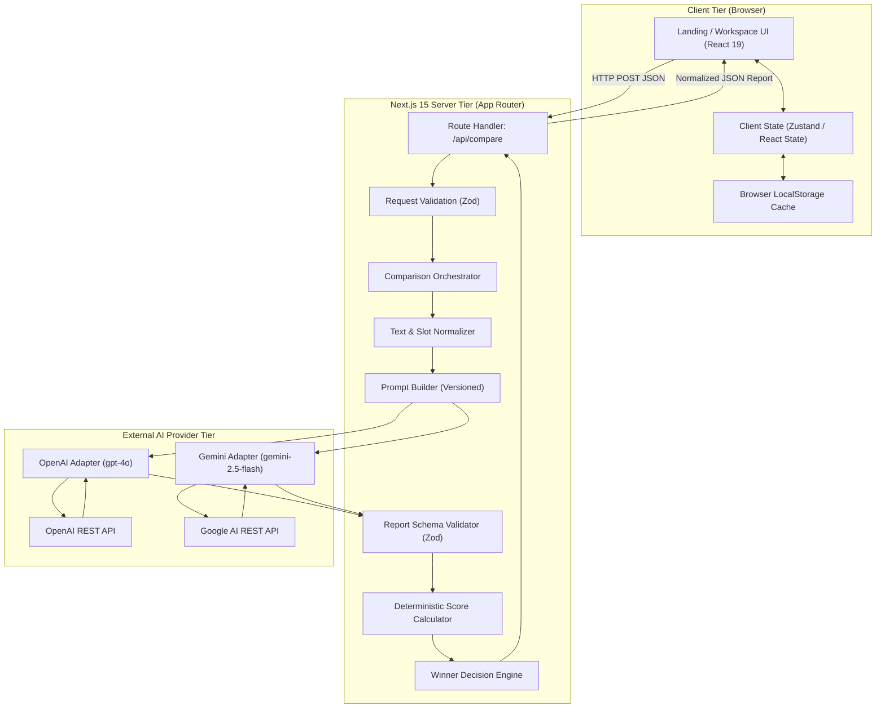
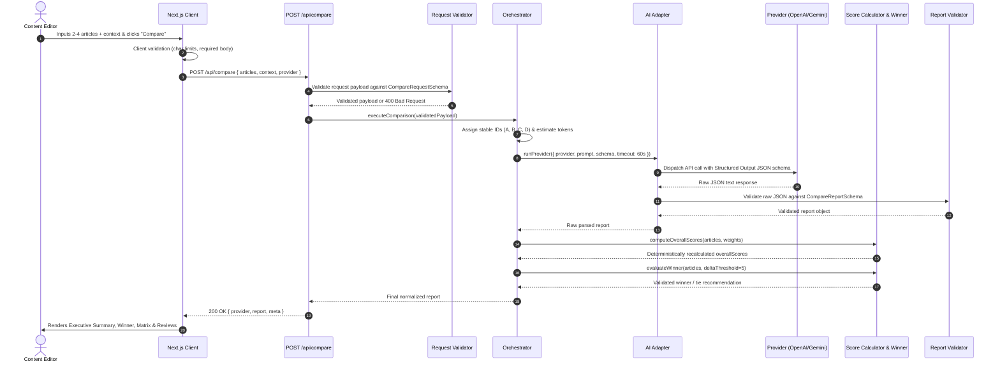

# 03 — System Architecture

**Product:** ArticleCompare AI  
**Architecture Style:** Next.js Modular Monolith  
**Runtime:** Node.js 20+ LTS / Vercel Edge & Serverless  
**Frontend Framework:** Next.js 15 (App Router, JavaScript/JSX)  
**State Architecture:** Stateless Server / Client Memory & LocalStorage Cache  

---

## 1. Architectural Strategy: The Modular Monolith

ArticleCompare AI adopts a **Modular Monolith** architecture. All presentation logic, API endpoints, orchestration services, domain models, and external AI provider adapters reside within a single, cohesive Next.js project.

### Why Modular Monolith?
- **Speed to Market**: Zero distributed systems overhead, zero RPC latency, and simplified local development (`npm run dev`).
- **Domain Boundaries**: Clear folder-based separation between UI components (`components/`), API routes (`app/api/`), comparison business logic (`lib/comparison/`), and AI integrations (`lib/ai/`).
- **Future Extractability**: If high-volume comparison traffic later requires isolated worker processes (e.g., dedicated GPU/LLM pipelines or asynchronous queue workers), the `lib/comparison/` and `lib/ai/` modules can be extracted cleanly into microservices without rewriting core logic.



---

## 2. Main System Modules & Responsibilities

| Module | Location | Primary Responsibilities |
|---|---|---|
| **Presentation Tier** | `components/`, `app/` | Manages page layouts, input slot editors, context drawers, responsive comparison grids, score matrices, radar/bar charts, and export modals. |
| **Route Handler Tier** | `app/api/compare/` | Serves as the HTTP entry point. Handles request lifecycle, logging, error translation, and HTTP status codes. |
| **Validation Layer** | `lib/validation/` | Enforces runtime data contracts on incoming user payloads using Zod (`compare-request.schema.js`). |
| **Comparison Domain** | `lib/comparison/` | Core business logic: text trimming, character counting, token estimation, deterministic score weighting (`score-calculator.js`), and winner resolution rules (`winner-selector.js`). |
| **AI Orchestration** | `lib/ai/` | Builds versioned system and user prompt strings (`prompt-builder.js`), provides response JSON schemas (`report-schema.js`), and routes execution to registered adapters. |
| **Provider Adapters** | `lib/ai/providers/` | Decoupled client integrations for OpenAI (`openai.adapter.js`) and Google Gemini (`gemini.adapter.js`). Handles authentication headers, model parameters, structured output schemas, and network retries. |
| **Storage & Caching** | `lib/utils/storage.js` | Client-only helper for saving and reading comparison history in `localStorage`. Zero server-side persistence. |

---

## 3. Detailed Request Lifecycle & Sequence

The end-to-end execution flow of an article comparison follows a strictly validated 10-stage lifecycle:



---

## 4. AI Provider Abstraction Interface

The AI integration is completely isolated from business logic via a clean contract. Neither the UI components nor the route handler make direct calls to provider SDKs.

### Provider Adapter Contract (`lib/ai/providers/base.adapter.js`)
```javascript
/**
 * @typedef {Object} ProviderResult
 * @property {Object} data - Parsed and validated report object
 * @property {Object} usage - Token usage metadata { promptTokens, completionTokens, totalTokens }
 * @property {string} provider - Provider name ('openai' | 'gemini')
 * @property {string} model - Exact model identifier used
 * @property {number} durationMs - Execution time in milliseconds
 */

export async function runProvider({
  provider,
  model,
  systemPrompt,
  userPrompt,
  responseSchema,
  timeoutMs = 60000
}) {
  // Routes to specific adapter based on provider identifier
}
```

### Provider Adapter Responsibilities:
1. **Header & Secret Management**: Securely injects server-side environment variables (`OPENAI_API_KEY` or `GEMINI_API_KEY`).
2. **Schema Enforcement**: Configures provider-native structured output (OpenAI `response_format: { type: "json_schema" }` or Gemini `responseSchema`).
3. **Timeout & Abort Controller**: Injects an `AbortSignal` with a 60-second deadline to prevent hanging serverless instances.
4. **Normalized Error Mapping**: Catches provider-specific exceptions (e.g., Gemini `RESOURCE_EXHAUSTED` or OpenAI `RateLimitError`) and transforms them into standardized application error codes.

---

## 5. Synchronous vs. Asynchronous Workload Strategy

### 5.1 MVP Strategy: Synchronous Processing
- For comparison batches of 2–4 articles within the standard limit (100–60,000 characters per article), modern frontier models (such as `gemini-2.5-flash` or `gpt-4o`) typically return structured outputs within **8 to 22 seconds**.
- A synchronous HTTP request (`POST /api/compare`) with a 60-second timeout provides an optimal user experience:
  - Immediate visual feedback without infrastructure overhead.
  - Zero requirement for background queues, Redis servers, database tables, or polling endpoints.
  - The client displays an animated progress indicator guiding the user through the evaluation stages.

### 5.2 Future Roadmap (Phase 2+): Asynchronous Job Model
When scaling to larger documents, bulk comparisons (5+ drafts), or slow deep-research workflows, the architecture transitions to an asynchronous queue model:
1. Client calls `POST /api/v1/comparisons` $\to$ Server enqueues job in Redis (BullMQ) and returns `202 Accepted { jobId }`.
2. Background worker consumes job, executes AI orchestration, and persists result to storage.
3. Client polls `GET /api/v1/comparisons/:jobId` or listens via Server-Sent Events (SSE).

---

## 6. Token Budgeting & Cost Safeguards

To prevent unexpected API billing spikes and ensure high availability, the server enforces strict input gating:

| Metric | Guardrail Limit | Enforcement Action |
|---|---|---|
| **Min Article Length** | 100 characters | Reject with 400 Bad Request |
| **Max Article Length** | 60,000 characters (~10,000–12,000 words) | Reject with 400 Bad Request |
| **Max Batch Size** | 4 articles | Reject with 400 Bad Request |
| **Max Total Request Tokens** | ~35,000 estimated tokens | Pre-flight validation gate |
| **Max Response Tokens** | 4,000 completion tokens | Hard ceiling on provider call |
| **Estimated Cost per 2-Draft Batch** | $\approx \$0.02 - \$0.05$ | Monitored via provider logs |

---

## 7. Deterministic Score Recalculation Engine

Large Language Models can occasionally make simple arithmetic mistakes when calculating a weighted sum across 10 distinct integer scores. To guarantee 100% mathematical accuracy:
1. The LLM is instructed to score each of the 10 dimensions from 0 to 100.
2. The server-side domain service (`lib/comparison/score-calculator.js`) extracts these dimension scores and applies the immutable weights:
   $$\text{Overall Score} = \text{round}\left(\sum_{i=1}^{10} \text{Dimension Score}_i \times \text{Weight}_i\right)$$
3. The LLM-supplied `overallScore` is overridden with this mathematically verified value before the report is returned to the client.
