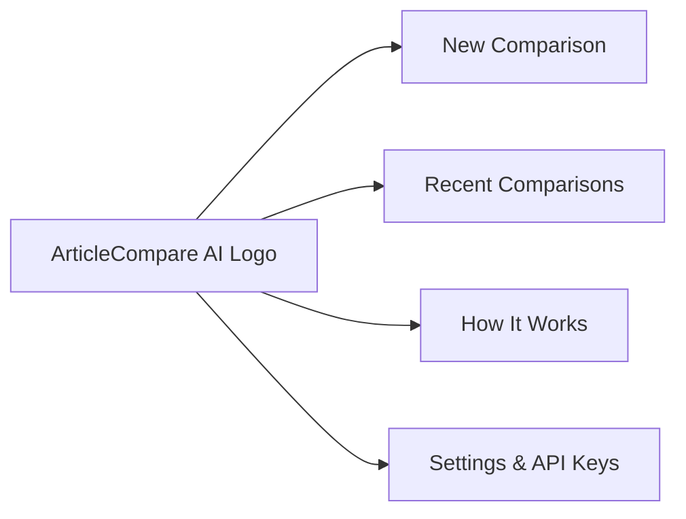

# 07 — UI/UX Specification

**Product:** ArticleCompare AI  
**Design Theme:** Blue / White / Enterprise  
**Visual Personality:** Clean, Analytical, Trustworthy, Calm, High-Productivity  
**Component System:** shadcn/ui (Radix UI) + Tailwind CSS + Lucide Icons  
**Target Accessibility:** WCAG 2.2 Level AA  

---

## 1. Visual Direction & Design Philosophy

ArticleCompare AI is an **editorial decision workspace**, not a conversational chatbot. The design communicates authoritative professionalism, data clarity, and focus.

### 1.1 Core Aesthetic Pillars
- **Light-First Architecture**: Crisp white background (`#FFFFFF`) with subtle cool-slate neutral tinting (`#F8FAFC`, `#F1F5F9`) for secondary cards.
- **Enterprise Blue Primary**: Deep, trustworthy sapphire blue (`#2563EB` / `#1D4ED8`) for primary CTAs, active tab indicators, and key metric emphasis.
- **Data-Dense Yet Scannable**: Information presented in structured grids, comparative matrices, and concise bullet points. Generous whitespace prevents cognitive fatigue during long reading sessions.
- **Semantic Accents Only**: Colors communicate status with purpose:
  - **Success / Winner**: Emerald Green (`#059669` / `#10B981`)
  - **Warning / Moderate**: Amber (`#D97706` / `#F59E0B`)
  - **Critical / Weakness**: Rose / Red (`#DC2626` / `#EF4444`)
  - **Info / Metadata**: Slate Blue (`#3B82F6` / `#64748B`)
- **Restraint Over Decoration**: Zero distracting 3D graphics, zero excessive saturated neon gradients, and zero non-functional micro-animations.

---

## 2. Navigation Architecture



### 2.1 Navigation Items
- **Brand / Home**: Logo mark (`Scale` / `FileSpreadsheet` icon + "ArticleCompare AI") with subtle version badge (`v1.0 MVP`).
- **New Comparison**: Primary active view for configuring and running comparisons.
- **History (Drawer)**: Client-side modal/drawer displaying locally cached reports saved in `localStorage`.
- **How It Works (Dialog)**: Quick modal explaining the 10-dimension rubric, score calculation, and evidence principles.
- **Settings (Popover)**: Quick indicator showing active AI provider (`Google Gemini` or `OpenAI`) and system status.

---

## 3. Screen Inventory & Wireframe Blueprint

### 3.1 Screen A: Header & Value Proposition
- Persistent clean top navigation bar (64px height, sticky with border bottom).
- Minimalist hero section introducing the workspace:
  - Headline: *"Compare Article Drafts with Editorial Intelligence"*
  - Subheadline: *"Evaluate 2–4 versions against a structured 10-dimension rubric. Uncover content gaps, score intent satisfaction, and generate defensible editorial decisions."*

---

### 3.2 Screen B: The Comparison Workspace (Input Stage)

```
┌─────────────────────────────────────────────────────────────────────────────────────────┐
│ [Logo] ArticleCompare AI         [How It Works]  [History (3)]  [Active Provider: Gemini]│
├─────────────────────────────────────────────────────────────────────────────────────────┤
│                                                                                         │
│  Article Slots: [ 2 Articles (Active) ]  [ 3 Articles ]  [ 4 Articles ]                 │
│                                                                                         │
│  ┌──────────────────────────────────┐  ┌──────────────────────────────────┐             │
│  │ Article A                        │  │ Article B                        │             │
│  │ Title: [Draft 1 - Clean Code... ]│  │ Title: [Draft 2 - Production Arch]│             │
│  │ [Paste Text] [Upload .txt/.md]   │  │ [Paste Text] [Upload .txt/.md]   │             │
│  │ ┌──────────────────────────────┐ │  │ ┌──────────────────────────────┐ │             │
│  │ │Building scalable Next.js...  │ │  │ │Next.js App Router deep dive..│ │             │
│  │ │                              │ │  │ │                              │ │             │
│  │ │                              │ │  │ │                              │ │             │
│  │ └──────────────────────────────┘ │  │ └──────────────────────────────┘ │             │
│  │ 1,420 words | 8,950 chars        │  │ 1,850 words | 11,200 chars       │             │
│  └──────────────────────────────────┘  └──────────────────────────────────┘             │
│                                                                                         │
│  ▸ Optional Editorial Context (Keyword, Intent, Audience, Tone) [Collapsed]             │
│                                                                                         │
│                     [ Compare Articles (Ctrl + Enter) -> ]                              │
└─────────────────────────────────────────────────────────────────────────────────────────┘
```

#### Key Workspace Controls:
1. **Slot Count Switcher**: Segmented toggle buttons (`2 Articles`, `3 Articles`, `4 Articles`). Switching preserves all existing text in slots A and B.
2. **Article Input Card**:
   - Distinct letter badge (`A`, `B`, `C`, `D`) with color-coded accent tag.
   - Title input with character counter (max 200).
   - Ingestion toolbars: "Paste" action and hidden `<input type="file">` supporting `.txt` and `.md`.
   - Textarea with monospace/sans switch, auto-expanding or scrollable (min 320px height).
   - Live character and word counters with validation pill (turns green when $\ge 100$ characters, red if $> 60,000$).
   - Clear slot button (with confirmation modal if text $> 500$ characters).
3. **Collapsible Context Drawer**:
   - Primary Keyword input.
   - Search Intent selector (`Informational`, `Commercial`, `Transactional`, `Navigational`).
   - Target Audience & Editorial Goal fields.
   - Tone & Publication Guidelines textarea.
4. **Primary Execution Button**: Large 48px height primary button, disabled until all active article slots satisfy $\ge 100\text{ characters}$.

---

### 3.3 Screen C: Analysis Loading & Progress Stepper
When the user clicks "Compare Articles", the workspace transitions to a focused, calm loading state:
- Interactive elements are locked to prevent duplicate submissions.
- Multi-step progress stepper:
  - Step 1: `Validating text drafts & token allocation...` (Completed ~1s)
  - Step 2: `Analyzing articles against 10-dimension rubric...` (Active pulse)
  - Step 3: `Evaluating textual evidence & synthesizing report...` (Pending)
- Reassuring microcopy: *"Evaluating drafts in parallel. This typically takes 12–20 seconds."*
- User-entered text is fully preserved in memory.

---

### 3.4 Screen D: Results Overview & Winner Banner

```
┌─────────────────────────────────────────────────────────────────────────────────────────┐
│ 🏆 WINNER RECOMMENDATION                                          [ Confidence: HIGH ]  │
│ Article B: Next.js Architecture: From Scratch to Production                             │
│ Overall Score: 85/100 (+7 vs. Article A)                                                │
│ Rationale: Article B delivers superior architectural depth, complete route handler      │
│ patterns, and actionable error boundary guidance without superficial fluff.             │
└─────────────────────────────────────────────────────────────────────────────────────────┘

┌─────────────────────────────────────────────────────────────────────────────────────────┐
│ 📊 EXECUTIVE SUMMARY & HYBRID RECOMMENDATION                                            │
│ Executive Summary:                                                                      │
│ Both drafts demonstrate strong Next.js comprehension. Article B is the stronger         │
│ foundational draft; Article A offers superior component readability.                    │
│                                                                                         │
│ Hybrid Strategy:                                                                        │
│ Adopt Article B as the core guide. Insert Section 3 from Article A for component       │
│ composition, and use Article A's cleaner code snippet for custom data hooks.            │
└─────────────────────────────────────────────────────────────────────────────────────────┘

┌─────────────────────────────────────────────────────────────────────────────────────────┐
│ 📋 10-DIMENSION COMPARATIVE MATRIX                                [ Export JSON / MD ]  │
│ ┌──────────────────────────────┬──────────┬──────────┬────────────────────────────────┐ │
│ │ Criterion                    │ Draft A  │ Draft B  │ Comparative Analysis           │ │
│ ├──────────────────────────────┼──────────┼──────────┼────────────────────────────────┤ │
│ │ Search-Intent (15%)          │    82    │    88    │ B addresses deployment intent. │ │
│ │ Accuracy & Evidence (15%)    │    80    │    85    │ B includes verified errors.    │ │
│ │ Depth & Completeness (12%)   │    72    │    87    │ B covers middleware & borders. │ │
│ │ Readability & Fit (10%)      │    88    │    82    │ A is more conversational.      │ │
│ │ Structure (10%)              │    78    │    86    │ B has better visual callouts.  │ │
│ │ Originality (8%)             │    70    │    84    │ B introduces custom domains.   │ │
│ │ Practical Examples (8%)      │    82    │    85    │ Both strong; B has full routes.│ │
│ │ On-Page SEO (8%)             │    75    │    82    │ B has better H2 keyword match. │ │
│ │ Topical Coverage (8%)        │    74    │    86    │ B covers full ecosystem.       │ │
│ │ Publication Readiness (6%)   │    80    │    84    │ B ready with minor Intro edits.│ │
│ ├──────────────────────────────┼──────────┼──────────┼────────────────────────────────┤ │
│ │ OVERALL SCORE (Weighted)     │    78    │    85    │ Decisive Advantage: Article B  │ │
│ └──────────────────────────────┴──────────┴──────────┴────────────────────────────────┘ │
└─────────────────────────────────────────────────────────────────────────────────────────┘
```

#### Special Winner States:
- **Decisive Winner**: Displayed when leading score margin $\ge 5\text{ points}$. Styled in Emerald/Blue with high-visibility trophy icon.
- **Close Race / Near Tie**: Displayed when score margin $< 5\text{ points}$. Styled in Amber/Slate with split banner: *"Close Race — Both drafts offer distinct strengths. Review trade-offs below."*
- **No Clear Winner (Revisions Needed)**: Displayed when all drafts score $< 60$ or contain critical flaws: *"No Clear Winner — Both drafts require significant structural revisions before publication."*

---

### 3.5 Screen E: Deep-Dive Article Cards (Tabs A, B, C, D)
Users can tab between articles to review detailed diagnostic evaluations:
- **Dimension Score Breakdown**: 10 horizontal progress bars with numerical values ($0–100$).
- **Strengths List**: Bullet points with green checkmarks highlighting concrete successes.
- **Weaknesses List**: Bullet points with amber caution icons detailing deficiencies.
- **Content Gaps**: Specific missing topics or sub-queries that should have been covered.
- **Editorial Issues**: Concrete notes on grammar, tone, pacing, or structure.
- **Textual Evidence Links**: Callout blocks citing specific headings or verbatim excerpts from the submitted text.

---

### 3.6 Screen F: Actionable Improvement Plan & SEO Suggestions
- **Prioritized Action Plan**:
  - Filterable by priority: `High`, `Medium`, `Low`.
  - Interactive checkboxes allow editors to check off tasks as they revise.
  - Each item includes: **Task Name**, **Detailed Action**, and **Reason/Justification**.
- **SEO Metadata Preview**:
  - Google SERP Snippet Preview (Desktop & Mobile view).
  - Recommended Title Tag (with character count indicator).
  - Recommended Meta Description (with character count indicator).
  - Clean URL slug.
  - Secondary keyword opportunities.
  - FAQ accordion ideas with suggested questions and answers.

---

## 4. Responsive Viewport Adaptations

| Viewport | Layout Strategy |
|---|---|
| **Desktop ($\ge 1280\text{px}$)** | Full side-by-side layout. Articles A & B displayed in 2 columns (or 3–4 columns with auto-grid). Matrix displayed in a comprehensive comparison table with sticky criterion column. |
| **Tablet ($768\text{px} - 1024\text{px}$)** | 2-column grid for 2 articles; tabbed interface for 3–4 articles. Matrix horizontally scrollable with clear shadow indicator. |
| **Mobile ($360\text{px} - 420\text{px}$)** | Single-column stacked cards. Sticky article tabs (`A`, `B`, `C`, `D`) for rapid switching. Fixed bottom bar with character counter and prominent "Compare" button. |

---

## 5. Interaction States & Transitions

Every button, input, tab, and card implements all 8 interaction states:
1. **Default**: Crisp borders (`border-slate-200`), clean typography, subtle background contrast.
2. **Hover**: Smooth color shifts (`bg-slate-50`, `border-blue-300`, duration 150ms).
3. **Focus**: High-visibility focus ring (`ring-2 ring-blue-500 ring-offset-2`).
4. **Active**: Subtle scale transform (`active:scale-[0.98]`).
5. **Disabled**: Reduced opacity (`opacity-50 cursor-not-allowed`).
6. **Loading**: Animated spinner with locked input controls and pulsing skeleton placeholders.
7. **Error**: Red border (`border-red-500`), subtle red wash (`bg-red-50/50`), and clear inline error text.
8. **Success**: Emerald accents (`border-emerald-500`, `text-emerald-700`).

---

## 6. Accessibility & WCAG 2.2 AA Compliance

- **Semantic Headings**: Strict page structure (`H1` for Page Title $\to$ `H2` for Workspace & Report Sections $\to$ `H3` for Card Headings).
- **Aria Roles**:
  - `role="tablist"` and `role="tab"` for slot count switcher and article detail tabs.
  - `aria-live="polite"` for character/word count updates and loading stepper notifications.
  - `aria-expanded` on the context accordion.
- **Contrast**: Tested minimum contrast of $4.6:1$ for normal body text and $7.1:1$ for primary buttons against white.
- **Reduced Motion**: All animations wrapped in `@media (prefers-reduced-motion: reduce)` with instantaneous fallback transitions.
