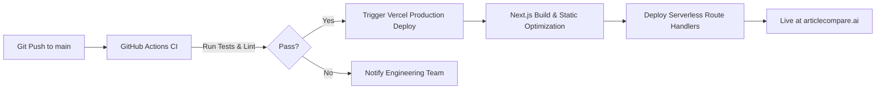

# 10 — Deployment and Operations

**Product:** ArticleCompare AI  
**Deployment Platform:** Vercel / Node.js 20+ LTS  
**Hosting Architecture:** Serverless Route Handlers & Edge UI Delivery  
**Database Requirement:** None (Stateless MVP)  

---

## 1. Target Environments

| Environment | Purpose | URL / Access | Secret Management |
|---|---|---|---|
| **Local Development** | Local feature implementation & testing | `http://localhost:3000` | `.env.local` (developer-owned) |
| **Preview / Staging** | Pull request verification & QA automated checks | `https://preview.articlecompare.ai` | Vercel Environment Variables (Staging team) |
| **Production** | Live end-user traffic | `https://articlecompare.ai` | Vercel Production Environment Variables |

---

## 2. Environment Variables & Secret Configuration

### 2.1 Complete Variable Specification
```env
# Application Core
NODE_ENV=production
APP_URL=https://articlecompare.ai

# AI Provider Selection
# Options: 'gemini' | 'openai' (default: 'gemini')
AI_PROVIDER=gemini

# Google Gemini Configuration
GEMINI_API_KEY=AIzaSy...
GEMINI_MODEL=gemini-2.5-flash

# OpenAI Configuration
OPENAI_API_KEY=sk-...
OPENAI_MODEL=gpt-4o

# Execution Limits
MAX_ARTICLE_CHARS=60000
MIN_ARTICLE_CHARS=100
MAX_ARTICLES=4
ANALYSIS_TIMEOUT_MS=60000
```

> [!IMPORTANT]
> **Gemini Model Alignment:**  
> Previous legacy starters referenced deprecated model identifiers. Ensure `GEMINI_MODEL` is set to active production models (e.g., `gemini-2.5-flash` or `gemini-1.5-pro`). Never hardcode model strings in source code; always fallback to `process.env.GEMINI_MODEL`.

---

## 3. Local Setup & Verification Guide

### 3.1 Initial Setup
```bash
# Clone the repository
git clone https://github.com/your-org/articlecompare-ai.git
cd articlecompare-ai

# Install dependencies
npm install

# Configure local environment variables
cp .env.example .env.local
# (Edit .env.local to insert valid GEMINI_API_KEY or OPENAI_API_KEY)

# Start local development server
npm run dev
```

### 3.2 Pre-Release Verification
```bash
# Run linting
npm run lint

# Run unit and integration tests
npm run test

# Run build verification
npm run build

# Start production server locally
npm run start
```

---

## 4. Production Deployment Workflow (Vercel)

Vercel provides native deployment for Next.js App Router applications with zero infrastructure management:



### Deployment Steps:
1. Connect Git repository to the Vercel dashboard.
2. Configure Project Settings:
   - Framework Preset: **Next.js**
   - Node.js Version: **20.x LTS**
3. Configure Environment Variables in Vercel Dashboard under **Settings $\to$ Environment Variables**:
   - `GEMINI_API_KEY` (Production secret)
   - `GEMINI_MODEL` (`gemini-2.5-flash`)
   - `OPENAI_API_KEY` (Production secret)
   - `OPENAI_MODEL` (`gpt-4o`)
   - `AI_PROVIDER` (`gemini`)
4. Trigger production deployment.
5. Verify SSL / Custom Domain DNS records (`CNAME` / `A` records).

---

## 5. Database Deployment (Not Applicable)

ArticleCompare AI MVP is **explicitly database-free**:
- Zero database provisioning is required.
- No `DATABASE_URL` or ORM packages (`prisma`, `drizzle`) are installed.
- No database migrations, connection pooling, or backup/restore runbooks are required.
- Comparisons are evaluated in volatile memory and returned directly to the client.

---

## 6. Observability, Logging & Error Telemetry

### 6.1 Structured Operational Logs
The server route handler emits structured JSON logs to standard output (captured by Vercel Logs / Datadog):
```json
{
  "timestamp": "2026-11-16T13:46:00.000Z",
  "level": "info",
  "requestId": "req_9f81a7b0-c6e2-4d2b-98f5-19e4827d3b01",
  "event": "comparison_completed",
  "provider": "gemini",
  "model": "gemini-2.5-flash",
  "articleCount": 2,
  "totalCharacters": 20150,
  "durationMs": 14250,
  "status": 200
}
```

### 6.2 Data Privacy in Logs
- **Prohibited Data**: Never log raw article content, draft excerpts, or provider API keys.
- **Allowed Telemetry**: Request IDs, duration, token usage numbers, status codes, and normalized error category strings.

---

## 7. Cost & Quota Management

1. **Provider Spending Caps**: Set hard monthly spending caps and budget alerts ($50, $100, $500) inside Google Cloud Platform and OpenAI billing consoles.
2. **Per-Request Character Ceiling**: Hard cap of 60,000 characters per article guarantees a single comparison will never exceed reasonable token limits.
3. **Execution Concurrency**: Configure Vercel serverless function concurrency limits to prevent sudden traffic bursts from exhausting provider API quotas.

---

## 8. Incident Response Runbooks

### 8.1 Upstream Provider Outage (OpenAI or Gemini Down)
1. **Symptom**: Spikes in `502 Bad Gateway` or `504 Gateway Timeout` errors.
2. **Immediate Action**:
   - Verify provider status page ([status.openai.com](https://status.openai.com) or Google Cloud status).
   - If secondary provider is operational, change `AI_PROVIDER` in Vercel Environment Variables (`gemini` $\leftrightarrow$ `openai`) and redeploy (or toggle via dashboard without code change).
   - UI automatically displays service degradation banner while preserving user drafts.

### 8.2 Exposed API Key
1. **Symptom**: Unauthorized usage alert from provider or secret detected in public repo.
2. **Immediate Action**:
   - Immediately navigate to provider dashboard and revoke the exposed key.
   - Generate a fresh API key.
   - Update Vercel environment variables and redeploy.
   - Audit usage logs during the compromise window.
