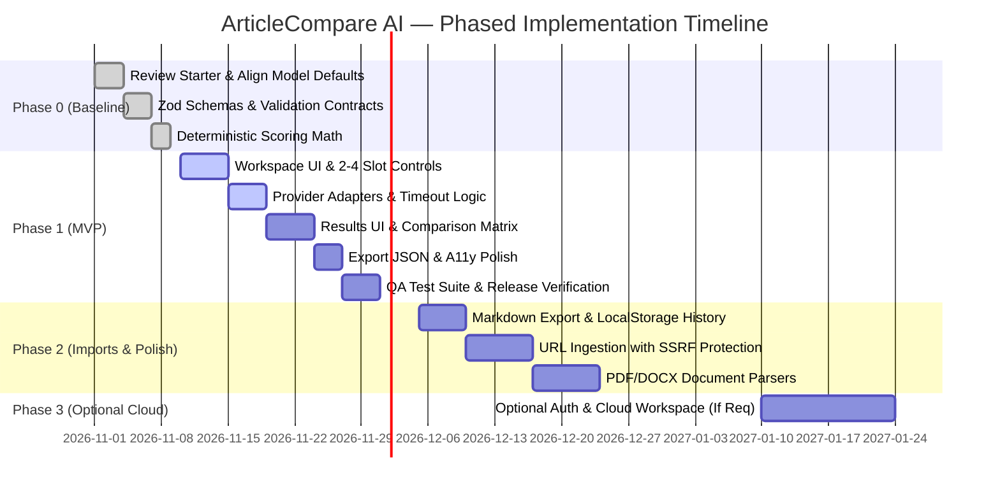

# 11 — Development Roadmap

**Product:** ArticleCompare AI  
**Current Phase:** Phase 0 $\to$ Phase 1 (MVP Delivery)  
**Lifecycle Status:** Active Implementation  

---

## 1. Roadmap Overview & Phasing

---

## 2. Detailed Phase Breakdown & Milestones

### Phase 0 — Baseline Review & Stabilization (Completed)
- **Objective**: Stabilize existing starter code and establish strict contracts.
- **Key Deliverables**:
  - Audit existing Next.js starter structure.
  - Correct Gemini and OpenAI model identifiers.
  - Define formal Zod schemas for request validation and report contracts.
  - Implement server-side deterministic scoring logic.
  - Isolate provider calls into decoupled adapters.

---

### Phase 1 — MVP Completion (Current Focus)
- **Objective**: Deliver a production-ready, reliable, database-free comparison workspace.
- **Key Deliverables**:
  - **M-1.1**: Polish 2–4 slot article editor with live character counters and file upload buttons.
  - **M-1.2**: Implement collapsible context drawer (Keyword, Intent, Audience, Goal, Tone).
  - **M-1.3**: Wire dual provider adapters (`gemini-2.5-flash`, `gpt-4o`) with 60-second timeouts.
  - **M-1.4**: Render Executive Summary, Winner Banner, and 10-Dimension Comparative Matrix.
  - **M-1.5**: Implement deep-dive Article Cards (Strengths, Weaknesses, Gaps, Evidence).
  - **M-1.6**: Implement Prioritized Action Plan and SEO Metadata preview.
  - **M-1.7**: One-click JSON report export.
  - **M-1.8**: Accessibility review (WCAG 2.2 AA) and responsive layout optimization.
- **Exit Criteria**: All 11 PRD acceptance criteria satisfied and QA test suite passing.

---

### Phase 2 — Ingestion & Usability Enhancements
- **Objective**: Expand ingestion options and streamline report sharing.
- **Key Deliverables**:
  - **M-2.1**: Browser-local comparison history via `localStorage` (last 5 reports).
  - **M-2.2**: Formatted Markdown (`.md`) report export.
  - **M-2.3**: Side-by-side synchronized reader for reviewing original drafts.
  - **M-2.4**: Safe URL ingestion service with strict SSRF defense (DNS verification, private IP blocking).
  - **M-2.5**: Client-side preview and inline editor for extracted URL/file text.
- **Exit Criteria**: URL ingestion passes SSRF security test suite with zero IP bypass vulnerabilities.

---

### Phase 3 — Optional Cloud Expansion (Only if Requirements Change)
- **Objective**: Support multi-device cloud persistence and user accounts if required by business expansion.
- **Key Deliverables**:
  - User authentication (NextAuth / Better Auth) with email and OAuth providers.
  - Cloud database (PostgreSQL via Neon / Supabase).
  - Cloud project folders, tag management, and shared report URLs.
- **Strict Rule**: Do not begin Phase 3 unless authenticated persistence becomes a confirmed business requirement.

---

### Phase 4 — Team Workspaces & Enterprise Governance
- **Objective**: Enable agency and publication team collaboration.
- **Key Deliverables**:
  - Organization accounts with Role-Based Access Control (Admin, Editor, Contributor).
  - Editorial review comments and threaded discussion on comparison reports.
  - Workspace usage metering and team API quota enforcement.
  - Audit logging for enterprise compliance.

---

### Phase 5 — Research & Editorial Intelligence
- **Objective**: Expand from text-only evaluation to evidence-assisted research.
- **Key Deliverables**:
  - Live search engine retrieval integration (Google Search API / Perplexity / Tavily) to verify factual assertions.
  - Automated claim-to-source mapping with external web citations.
  - Hybrid final-draft interactive editor synthesizing winning sections directly inside the app.
  - Direct CMS publishing hooks (WordPress REST API, Webflow CMS API).
