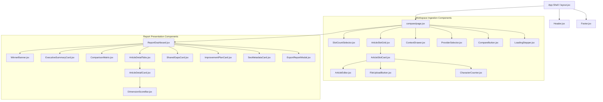

# Design System: Component Specifications & Architecture

**Product:** ArticleCompare AI  
**Component Architecture:** shadcn/ui (Radix UI Primitives) + Tailwind CSS + Lucide React  
**Implementation Standard:** Accessible, Type-Safe via Runtime Contracts, Zero Runtime Overhead  

---

## 1. Component Hierarchy & Dependency Map

The user interface is broken down into modular, single-responsibility components categorized into **Workspace Ingestion** and **Report Presentation**:

---

## 2. Ingestion & Workspace Components

### 2.1 `SlotCountSelector.jsx`
- **Purpose**: Allows the user to select between 2, 3, or 4 comparison slots.
- **Props**:
  - `activeCount`: `number` (`2 | 3 | 4`)
  - `onChange`: `(count: number) => void`
  - `disabled`: `boolean`
- **UI Spec**:
  - Rendered as an accessible segmented control (`role="radiogroup"`).
  - Active button: `bg-white text-blue-700 shadow-sm font-semibold`.
  - Inactive button: `text-slate-600 hover:text-slate-900`.
- **Safety**: Switching down (e.g., from 3 slots to 2) prompts a confirmation modal if Slot C contains $> 200$ characters of text.

### 2.2 `ArticleSlotCard.jsx`
- **Purpose**: Container for each article draft input slot.
- **Props**:
  - `slotId`: `'A' | 'B' | 'C' | 'D'`
  - `title`: `string`
  - `content`: `string`
  - `onTitleChange`: `(title: string) => void`
  - `onContentChange`: `(content: string) => void`
  - `onClear`: `() => void`
- **Key Features**:
  - Top header displaying colored letter badge (`bg-blue-100 text-blue-700 font-bold`).
  - Title input with placeholder (`"Enter article title (optional)..."`).
  - Quick action toolbar:
    - **Paste from Clipboard** (`navigator.clipboard.readText()`).
    - **Upload .txt / .md** (`FileUploadButton`).
    - **Clear Text** (trash icon with confirmation).
  - Sub-footer displaying live character counter, word count, and validation status indicator.

### 2.3 `ArticleEditor.jsx`
- **Purpose**: Primary text editing canvas for draft bodies.
- **Visual Styling**:
  - Clean `textarea` with `resize-y`, minimum height `320px`.
  - Font styling: `font-sans text-sm text-slate-800 leading-relaxed`.
  - Focus state: `focus:outline-none focus:ring-2 focus:ring-blue-500/20 focus:border-blue-500`.
- **Validation Feedback**:
  - Red ring if $> 60,000$ characters.
  - Subtle amber highlight if $< 100$ characters when comparison is triggered.

### 2.4 `ContextDrawer.jsx`
- **Purpose**: Expandable panel housing optional metadata to steer evaluation.
- **Accordion Header**:
  - Display: *"Optional Editorial Context & SEO Targets"* with chevron toggle.
  - Active indicator tag showing how many context parameters are configured (e.g., `"3 configured"`).
- **Form Controls**:
  - `primaryKeyword`: Single-line text input with search icon.
  - `searchIntent`: Pill selector (`Informational`, `Commercial`, `Transactional`, `Navigational`).
  - `audience`: Input (`e.g., Senior Software Engineers, Beginners`).
  - `goal`: Input (`e.g., Comprehensive definitive guide, Quick tutorial`).
  - `tone`: Dropdown (`Authoritative`, `Conversational`, `Technical`, `Journalistic`).
  - `guidelines`: Multi-line text input for publication-specific rules.

### 2.5 `LoadingStepper.jsx`
- **Purpose**: Guides user through the asynchronous evaluation lifecycle.
- **UI Animation**:
  - Centered card with clean background blur (`bg-white/95 backdrop-blur-sm`).
  - 3 sequential steps with animated status rings:
    1. `Validating Text & Token Allocations`: Green checkmark.
    2. `Evaluating Against 10-Dimension Rubric`: Pulsing blue spinner with animated progress glow.
    3. `Synthesizing Scores & Verifying Evidence`: Pending gray circle.
  - Microcopy: *"Comparing 2 drafts across 10 editorial dimensions. Average time: 14s."*

---

## 3. Reporting & Presentation Components

### 3.1 `WinnerBanner.jsx`
- **Purpose**: Prominently displays the winner recommendation or near-tie result.
- **Three Render States**:
  1. **Decisive Winner** ($\Delta \ge 5\text{ pts}$):
     - Background: `bg-emerald-50/80 border-emerald-200`.
     - Icon: Golden Trophy / Emerald Sparkle.
     - Headline: `🏆 Winner Recommendation: Article [X] — [Title]`.
     - Metrics: Overall Score badge (`85/100`), margin tag (`+7 pts`), Confidence badge (`High Confidence`).
     - Summary: 2–3 sentences explaining the decisive evidence.
  2. **Close Race / Near Tie** ($\Delta < 5\text{ pts}$):
     - Background: `bg-amber-50/80 border-amber-200`.
     - Icon: Scales / Balance icon.
     - Headline: `⚖️ Close Race — Both Drafts Offer Distinct Strengths`.
     - Summary: Bulleted breakdown of where Draft A won vs. where Draft B won.
  3. **No Clear Winner (Revisions Required)** (All $< 60$ or critical flaws):
     - Background: `bg-rose-50/80 border-rose-200`.
     - Icon: Alert Triangle.
     - Headline: `⚠️ Substantial Editorial Revisions Recommended`.
     - Summary: Critical warnings explaining why neither draft is publication-ready.

### 3.2 `ComparisonMatrix.jsx`
- **Purpose**: Interactive, side-by-side comparative table mapping all 10 criteria.
- **Layout & Columns**:
  - Column 1: **Criterion & Weight** (e.g., `Search-Intent (15%)`).
  - Columns 2–5: **Draft Scores** (`Draft A`, `Draft B`, and optional `C`, `D`).
  - Final Column: **Comparative Editorial Analysis** (concise breakdown of why one scored higher).
- **Interactive Highlighting**:
  - The highest score in each row is tagged with a subtle emerald pill (`bg-emerald-100 text-emerald-800 font-semibold`).
  - Clicking any criterion row expands an inline drawer showing detailed score rationale and evidence excerpts.

### 3.3 `DimensionScoreBar.jsx`
- **Purpose**: Renders horizontal score bars in article detail views.
- **Props**:
  - `label`: `string`
  - `score`: `number` ($0–100$)
  - `weight`: `string` (e.g., `"15%"`)
- **Color Bands**:
  - $90–100$: `bg-emerald-500` (Exceptional)
  - $80–89$: `bg-blue-600` (Strong)
  - $70–79$: `bg-slate-500` (Satisfactory)
  - $60–69$: `bg-amber-500` (Needs Work)
  - $0–59$: `bg-rose-500` (Critical Deficiencies)

### 3.4 `ImprovementPlanCard.jsx`
- **Purpose**: Prioritized, actionable editorial revision checklist.
- **Filter Tabs**: `All (5)`, `High Priority (2)`, `Medium (2)`, `Low (1)`.
- **Card Item Spec**:
  - Interactive HTML `<input type="checkbox">` that toggles strikethrough styling and saves completion state in client component state.
  - Priority badge:
    - High: `bg-rose-100 text-rose-800`
    - Medium: `bg-amber-100 text-amber-800`
    - Low: `bg-slate-100 text-slate-700`
  - Task title and detailed justification citing article draft issues.

### 3.5 `SeoMetadataCard.jsx`
- **Purpose**: Pre-computed search engine snippet and on-page metadata suggestions.
- **Components**:
  - **SERP Snippet Simulator**: Live Google search preview showing suggested Title, URL slug, and Meta Description.
  - **Title Tag Preview**: Character counter indicating optimal SERP length ($\le 60$ chars).
  - **Meta Description Preview**: Character counter indicating optimal length ($\le 160$ chars).
  - **Secondary Keywords**: Tag cloud of relevant semantic search entities.
  - **FAQ Accordion**: 3–5 search-aligned question/answer pairs ready for Schema.org JSON-LD integration.

### 3.6 `ExportReportModal.jsx`
- **Purpose**: Modal dialog allowing user to download comparison reports.
- **Export Options**:
  - **Download JSON** (`application/json`): Complete normalized schema for programmatic ingestion.
  - **Download Markdown** (`text/markdown`): Formatted GitHub-flavored markdown with score tables and callout alerts.
  - **Copy Summary to Clipboard**: One-click executive summary copying.
