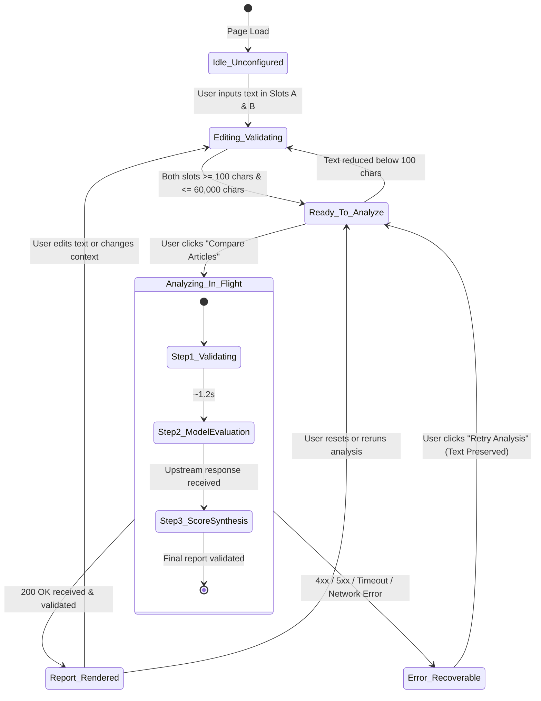

# Design System: Interaction States & Motion Architecture

**Product:** ArticleCompare AI  
**Design Intelligence:** `ui-ux-pro-max` | `ui-styling`  
**State Model:** Deterministic State Machine  
**Motion Standard:** Subtle, Purposeful, Reduced-Motion Accessible  

---

## 1. Application State Machine

The client application transitions through five core primary states, backed by strict transition guards:



---

## 2. Interaction State Matrix for All Core Controls

Every interactive component implements all 8 standardized states:

| Component | Default | Hover | Focus | Active | Disabled | Loading | Error | Success |
|---|---|---|---|---|---|---|---|---|
| **Compare Button** | `bg-blue-600 text-white shadow-sm` | `bg-blue-700 shadow-md` | `ring-2 ring-blue-500 ring-offset-2` | `scale-[0.98]` | `bg-slate-200 text-slate-400 cursor-not-allowed` | `bg-blue-600/80 cursor-wait` (spinner) | `bg-rose-600 text-white` | `bg-emerald-600 text-white` |
| **Article Textarea** | `border-slate-200 bg-white` | `border-slate-300` | `border-blue-500 ring-2 ring-blue-500/20` | `border-blue-600` | `bg-slate-100 cursor-not-allowed` | `opacity-75 pointer-events-none` | `border-rose-500 ring-rose-500/20` | `border-emerald-500/50` |
| **Slot Toggle Pill** | `bg-slate-100 text-slate-600` | `bg-slate-200 text-slate-800` | `ring-2 ring-blue-400` | `scale-[0.98]` | `opacity-40` | `pointer-events-none` | N/A | `bg-white text-blue-700 shadow-sm` |
| **Context Accordion** | `border-slate-200 bg-slate-50/50` | `bg-slate-100/70` | `ring-2 ring-blue-400` | `bg-slate-100` | `opacity-50` | N/A | `border-rose-300` | `border-blue-200` |
| **Matrix Row** | `border-b border-slate-100` | `bg-blue-50/30 cursor-pointer` | `bg-blue-50/50 outline-none` | `bg-blue-100/40` | N/A | N/A | N/A | `bg-emerald-50/40` |
| **Checklist Item** | `text-slate-800` | `bg-slate-50 rounded-md` | `ring-2 ring-blue-400` | N/A | `opacity-50` | N/A | N/A | `line-through text-slate-400` |

---

## 3. Dynamic Validation Feedback & Guardrails

### 3.1 Character Count Threshold Visuals
- **Below Minimum ($< 100\text{ characters}$)**:
  - Counter badge displays: `84 / 100 min chars` in `text-slate-400`.
  - Primary button remains disabled (`opacity-50 cursor-not-allowed`).
  - Tooltip on button: *"Each draft requires at least 100 characters before analysis can begin."*
- **Valid Range ($100 - 55,000\text{ characters}$)**:
  - Counter badge displays: `1,420 words | 8,950 chars` in `text-emerald-700 bg-emerald-50`.
  - Primary button becomes active and prominent.
- **Approaching Ceiling ($55,001 - 60,000\text{ characters}$)**:
  - Counter badge displays: `58,200 / 60,000 chars` in `text-amber-700 bg-amber-50`.
- **Exceeding Ceiling ($> 60,000\text{ characters}$)**:
  - Textarea border turns red (`border-rose-500`).
  - Counter badge displays: `62,100 / 60,000 chars (Too Long)` in `text-rose-700 bg-rose-50 font-bold`.
  - Primary button disabled until text is trimmed.

---

## 4. Analysis Loading Progression & Stepper Timing

To provide a smooth, transparent user experience during the 12–20 second evaluation:

```
0s                  1.2s                                         12.8s                   14.5s
|-------------------|--------------------------------------------|-----------------------|
  Step 1: Validate    Step 2: AI Evaluation & Matrix Mapping       Step 3: Verification    Report
  (Instant checks)    (Dual provider call with Low Temp 0.2)       (Score calculation)     Rendered
```

- **Step 1 (0.0s – 1.2s)**: Local validation check, stable slot ID tagging (`A`, `B`), whitespace cleanup, and estimated token allocation. Marked with green checkmark.
- **Step 2 (1.2s – 12.8s)**: Serverless function routes payload to Gemini/OpenAI adapter. Client displays pulsating blue indicator: *"Evaluating drafts against 10-dimension rubric..."*
- **Step 3 (12.8s – 14.5s)**: Response parsed, validated against Zod schema, overall score deterministically computed, and winner confidence verified.
- **Completion (14.5s)**: Smooth transition to report overview with automatic gentle scroll (`scroll-mt-16`) to the Winner Banner.

---

## 5. Error Recovery States & User Feedback

| Error Scenario | User Interface Presentation | Recovery Action |
|---|---|---|
| **Upstream Provider Timeout (504)** | Amber alert banner: *"The AI provider did not respond within 60 seconds. Your drafts are safe."* | "Retry with Gemini" button and "Switch to OpenAI" button. Inputs intact. |
| **Rate Limit / Quota Exceeded (429)** | Slate alert banner: *"Provider rate limit reached. Please wait 30 seconds before retrying."* | 30-second countdown timer on button. |
| **Malformed Response (502)** | Rose alert banner: *"The AI model returned an incomplete response. Please try again."* | Single-click "Retry Analysis" button with automatic temperature jitter. |
| **Network Loss in Browser** | Red offline badge: *"You are currently offline. Check your internet connection."* | Auto-resumes when online event fires (`window.addEventListener('online')`). |

---

## 6. Micro-Interactions & Animation Curves

All UI animations are configured using CSS hardware acceleration and calibrated cubic-bezier curves:

### 6.1 Standard Motion Curves
- **Standard Easing**: `cubic-bezier(0.4, 0.0, 0.2, 1)` (used for card hovers, modal fades).
- **Decelerated Easing**: `cubic-bezier(0.0, 0.0, 0.2, 1)` (used for slide-in drawers and accordions).
- **Accelerated Easing**: `cubic-bezier(0.4, 0.0, 1, 1)` (used for closing dialogs).

### 6.2 Key Micro-Interactions
1. **Interactive Checklist Toggle**:
   - Checking a task checkbox scales the check icon (`scale-[1.15] \to scale-100` over 150ms).
   - Text transitions smoothly to `line-through text-slate-400 opacity-60`.
2. **Context Accordion Expansion**:
   - Smooth height interpolation using CSS Grid (`grid-template-rows: 0fr \to 1fr`) over 200ms.
   - Chevron icon rotates $180^\circ$ smoothly (`transition-transform duration-200`).
3. **Winner Banner Entry**:
   - Gentle fade-in and slide-up (`translate-y-2 \to translate-y-0` with opacity over 300ms).

### 6.3 Reduced Motion Accessibility
When `prefers-reduced-motion: reduce` is detected in user system preferences:
- All transitions and transform animations are set to `transition: none !important; animation: none !important;`.
- Progress bars and spinners render static state indicators.
